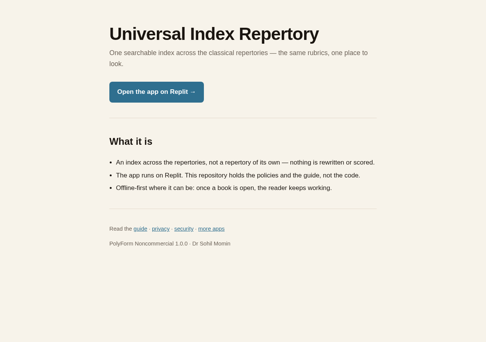

<div align="center">

[](LICENSE)
[](VERSION)
[](https://drsamonline.github.io/UniRep/app/)
[](#run-it-locally)


# Universal Index Repertory



**The repertory, indexed — a single searchable index across the classical repertories.**

[**Open the app**](https://drsamonline.github.io/UniRep/app/) &nbsp;·&nbsp;
[**Run it locally**](#run-it-locally) &nbsp;·&nbsp;
[Guide](docs/GUIDE.md) &nbsp;·&nbsp;
[Audit](docs/AUDIT.md) &nbsp;·&nbsp;
[Privacy](PRIVACY.md) &nbsp;·&nbsp;
[Security](SECURITY.md)

</div>

---

## What it is

UniRep is a **universal index** over the classical homoeopathic repertories: one search surface
across several books, so a rubric can be found by what it says rather than by remembering which
volume printed it.

The app lives in this repository, under [`app/`](app): an Expo (React Native) application that
runs entirely on your device — Android, iOS, Windows, Linux, or a browser — with the repertory
already inside it. There is no server and no account.

This repository also carries the project's policy documents — the privacy policy and the security
policy — which apply to the application wherever it is run.

## Run it locally

```sh
cd app
pnpm install
../scripts/prepare-app-data.sh     # builds the core database the app bundles
pnpm start                         # phone / emulator
pnpm run export:web                # static web build in app/dist
```

`prepare-app-data.sh` needs Python 3 and clones the converted repertory JSON on first run. It
writes a generated database that is deliberately not tracked — read
[unirep_data/DATA-LICENSES.md](unirep_data/DATA-LICENSES.md) first, because a build containing the
GPL v3 repertory is itself GPL v3.

## What it does not do

- No account, no sign-in, no profile.
- No server-side storage of your searches or your cases.
- No analytics and no third-party requests from the app.

See [PRIVACY.md](PRIVACY.md) for the full statement, and [SECURITY.md](SECURITY.md) for how to
report a problem.

## The data core

The searchable core is a SQLite database built from the converted repertory JSON in
[drsamonline/homoeopathic-materia-medica-repertory-json](https://github.com/drsamonline/homoeopathic-materia-medica-repertory-json):
real rubric text, real remedy links, grades only where the source prints them, and no FTS5
table (so the file opens in the WASM SQLite the offline build uses).

```sh
python3 scripts/build_core_db.py --source-dir ../hmr-json            # GPL-3.0 data
python3 scripts/build_core_db.py --source-dir ../hmr-json --cc0-only # CC0 data
```

Generated databases are **not tracked**, and the data is licensed separately from the
code — including a GPL v3 repertory in the build makes the output GPL v3. Read
[unirep_data/DATA-LICENSES.md](unirep_data/DATA-LICENSES.md) before distributing one.

## Support

| | |
|---|---|
| UPI (India) | `drsohilboi@ybl` — payee Dr Sohil Momin, open amount, or scan [the QR](docs/assets/upi-qr.svg) |
| GitHub Sponsors | [github.com/sponsors/drsamonline](https://github.com/sponsors/drsamonline) |
| Ko-fi | [ko-fi.com/matneo](https://ko-fi.com/matneo) |
| PayPal | [paypal.me/drsohilmomin](https://paypal.me/drsohilmomin?locale.x=en_GB&country.x=IN) |
| My books | [Amazon author store](https://www.amazon.com/stores/author/B08ZT331LY/allbooks?ccs_id=aed72b9f-71d9-41dc-adee-e9368a317acc) |
| More apps | [drsamonline.github.io](https://drsamonline.github.io/) |
| Email | [sohilmomin2000@gmail.com](mailto:sohilmomin2000@gmail.com) |

## Licence

© 2026 Dr Sohil Momin. All rights reserved. The repertory texts indexed by the app are public
domain; the index, the application and its interface are not.
